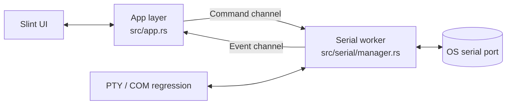

# CitrusPort Agent Guide

CitrusPort is a Rust 2024 + Slint desktop serial-port terminal for Linux and Windows. The UI title is **CitrusPort**; the Cargo package and default binary are `citrus-port`.

User-facing documentation lives in [README.md](README.md). This guide is intentionally short: it covers commands, architecture, invariants, tests, and current gaps.

## Quick commands

| Task | Linux / Unix | Windows PowerShell |
| --- | --- | --- |
| Run the app | `cargo run --locked` | `cargo run --locked` |
| Debug build | `./scripts/build.sh --platform linux --profile debug` | `.\scripts\build.ps1 --platform windows --profile debug` |
| Debug + release tests | `./scripts/build.sh --platform linux --profile both --test` | `.\scripts\build.ps1 --platform windows --profile both --test` |
| Regular tests | `cargo test --locked` | `cargo test --locked` |
| Unix PTY tests | `cargo test --locked --test pty_regression` | n/a |
| Windows COM tests | n/a | `cargo test --locked --test com_regression -- --ignored --nocapture` |
| Release package | `./scripts/deploy.sh --platform linux --profile release` | `.\scripts\deploy.ps1 --platform windows --profile release` |

- Omit `--offline` for a first build; Cargo must fetch dependencies. Add it only when the registry cache is ready.
- Build scripts write an English report to `test-results.txt` when `--test` is used.
- `--platform` accepts `native`, `linux`, `windows`, `all`; `--profile` accepts `debug`, `release`, `both` (`--mode` is an alias).
- Build scripts also support `--target`, `--test-only`, `--ignored`, `--report`, and `--clean`.
- Deploy scripts add `--out <dir>` (default `dist/`) and `--skip-build`.

## Project layout

| Path | Responsibility |
| --- | --- |
| `build.rs`, `src/lib.rs`, `src/main.rs` | Compile `ui/app-window.slint`. The library exports `serial`, `app`, and Slint components. `main.rs` only creates `MainWindow` and calls `App::run`. |
| `ui/app-window.slint` | Main window, serial settings, receive/send panels, navigation rail, and the settings page (language + theme). |
| `ui/i18n.slint` | Global `I18n` dictionary. Every user-facing string is a computed property selected by `lang` (`zh` or `en`). |
| `ui/material-widgets.slint`, `ui/material-theme.slint` | Material-style widgets and semantic color tokens. `MaterialTheme.theme-id` selects `citrus-dark`, `citrus-light`, or `catppuccin-mocha`. `MaterialPortField` supports manual entry plus discovery; `MaterialReceiveView` is the log view. |
| `src/app.rs`, `src/app/tests.rs` | UI callbacks, event pump, receive decoding/log state, byte counts, pending TX display queue, `SendRequest`, and settings persistence. Private-state tests and log performance sampling live in `src/app/tests.rs`. |
| `src/serial/manager.rs` | Worker thread owns `SerialPort`; commands and events use `crossbeam-channel`. Port discovery runs about every 3 s; CTS is polled about every 250 ms. |
| `src/serial/{config,event,error,encoder,decoder,format}.rs` | Serial config, commands/events, errors, UTF-8/GBK/ASCII codecs, HEX and newline conversion. |
| `tests/pty_regression.rs`, `tests/common/mod.rs` | Unix PTY fixture and shared cross-platform transfer scenarios. |
| `tests/com_regression.rs` | Windows COM fixture, gated by `#![cfg(windows)]`. |
| `scripts/build.*`, `scripts/deploy.*` | Build, test, report, and package scripts for both platforms. |
| `.github/workflows/ci-release.yml` | Linux/Windows build and test; tag builds publish release archives and checksums. |

## Architecture



- The worker thread is the only owner of `SerialPort`. Never perform serial I/O on the UI thread.
- UI code sends `Command` values and consumes `Event` values. `Event::Sent` is emitted only after `write_all` succeeds.
- `slint::invoke_from_event_loop` returns worker events to the UI thread. All Slint property updates happen there.
- Adjacent `Received` events are merged. RX text is flushed to the UI at about 30 Hz, and `RxBuffer` is capped at 5 MiB with amortized trimming.
- `SendRequest` is the shared text/HEX/encoding/newline entry point for the UI and tests.
- `Disconnected` resets the decoder and clears unconfirmed pending TX entries.
- Port names are passed through exactly as entered when they are not found in the discovery cache.
- Language and theme changes only update Slint properties; they never touch the serial worker or buffers.
- `lang` and `theme-id` persist to `citrus-port/config.toml` under `XDG_CONFIG_HOME`/`~/.config` (Linux) or `APPDATA` (Windows). Missing or invalid values fall back silently to `zh` and `citrus-dark`.

## Invariants

- Keep blocking serial I/O out of UI callbacks.
- Do not bypass `SendRequest` for sending data.
- Do not show a TX log entry before `Event::Sent`.
- Keep RX memory bounded; do not remove the trim path.
- Preserve the `Command` / `Event` contract when adding features.
- Keep platform-specific tests behind `#![cfg(unix)]` or `#![cfg(windows)]`.
- Keep test report labels and summaries in English.
- Add user-facing strings to `ui/i18n.slint`; do not hardcode display text in `.slint` files.
- Use `MaterialTheme` semantic tokens for colors so every theme stays consistent.
- Do not pass `--offline` in CI build steps; GitHub runners need network access for the first build.

## Testing

On x86_64 Linux, `cargo test --locked --offline` currently runs **20 regular tests**:

- 16 library tests: port resolution, send encoding, counters, reconnect queue, RX trim, settings defaults/round-trip/fallback, localized backend text and serial errors.
- 4 PTY tests: bidirectional bytes, repeated close/reopen, peer disconnect, application send paths.

Two performance samples are `#[ignore]`:

```bash
cargo test --locked --offline --test pty_regression -- --ignored --nocapture perf_pty_backend
cargo test --locked --offline -- --ignored --nocapture perf_app_state
```

Local dev baseline (PTY, 512 B x 400 frames): receive p50 about 0.6-0.8 ms, p99 about 16.9 ms, roughly 11.5 MiB/s; single-frame send round trip p50 about 2.1 ms; bulk send 31-47 MiB/s. These are observations, not cross-machine thresholds.

Windows COM tests require a connected port pair:

```powershell
$env:CITRUS_TEST_PORT_A = "COM3"
$env:CITRUS_TEST_PORT_B = "COM4"
cargo test --locked --test com_regression -- --ignored --nocapture
```

The report contains platform, target, profile, command, exit code, PASS/FAIL, parsed test counts, and raw output. See `test-results.txt` after running the build script with `--test`.

## Current gaps

- Windows native builds, PowerShell scripts, and COM regression have not been verified locally. The Linux environment has no Windows toolchain or PowerShell.
- `/dev/pts/N` manual opening, sustained-traffic selection stability, and GUI responsiveness still need manual checks.
- CTS/RTS/Break, hardware flow control, USB removal, and real-device timing need hardware validation.
- The paired virtual UART driver for RTS/CTS pause/resume acceptance is not implemented.
- A controllable fake backend for write-failure logging tests is still missing.
- Live language/theme switching and restart persistence have been compile/test checked, but still need manual GUI verification.
- Waveform and protocol-analysis tabs are placeholders.

## CI and release

`.github/workflows/ci-release.yml` runs `build.sh` on Ubuntu and `build.ps1` on Windows without `--offline`, then uploads test reports. Tag builds package prebuilt release binaries with `deploy.* --skip-build --out dist-*`. The release job downloads each platform artifact into its own directory, merges both `SHA256SUMS` files, flattens archives, verifies checksums, and publishes the GitHub release.

