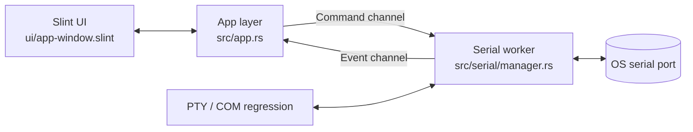

<div align="center">

# CitrusPort

**A focused serial-port workbench for Linux and Windows.**

Rust + Slint · text & HEX · UTF-8 / GBK / ASCII · RTS / CTS / Break · in-process PTY and COM regression tests

[](https://github.com/iesaka22333/citrus-port/actions/workflows/ci-release.yml)
[](Cargo.toml)
[](#download-and-install)
[](Cargo.toml)
[](https://slint.dev/)
[](#license)

**English** · [简体中文](README.zh-CN.md)

[Overview](#overview) · [Features](#features) · [Download & Install](#download-and-install) · [Quick Start](#quick-start) · [Build & Test](#build-and-test) · [Architecture](#architecture) · [Performance](#performance) · [Troubleshooting](#troubleshooting) · [Roadmap](#roadmap) · [License](#license)

</div>

---

## Overview

> CitrusPort is a desktop serial terminal for talking to microcontrollers, adapters, modems, and anything else that shows up as a serial port.

It combines a compact Material-style UI with a threaded serial backend: port discovery, text and raw-byte transfer, streaming decoders, a bounded traffic log, and control-line access. The app is built with Rust and [Slint](https://slint.dev/) and runs on Linux and Windows.

| At a glance | |
| :-- | :-- |
| **Fast to start** | Discover ports automatically or type a device path, then open with 115200 / 8N1 defaults. |
| **Text and bytes** | UTF-8, GBK, ASCII, HEX send, optional line endings, exact byte control. |
| **Usable logs** | Timestamps, selectable text, `Ctrl+C`, auto-scroll, clear, and save to a file. |
| **Real control lines** | CTS state display, RTS and Break operations through `serialport`. |
| **Regression ready** | In-process PTY tests on Unix, COM-pair tests on Windows, shared transfer scenarios. |

---

## Features

| | Feature | Details |
| :-- | :-- | :-- |
| 🔌 | **Ports** | Periodic discovery with product names, plus a manually editable path field. |
| ⚙️ | **Serial settings** | Baud rate, 5–8 data bits, None/Even/Odd parity, 1/2 stop bits, XON/XOFF or RTS/CTS flow control. |
| 🔤 | **Encodings** | UTF-8, GBK, and ASCII. GBK sends real GBK bytes; ASCII rejects non-ASCII input. |
| 🔁 | **Send modes** | Text or HEX, with CRLF / LF / CR / NONE line ending. HEX mode parses `01 02 FF`-style input. |
| 📜 | **Receive log** | Timestamped stream, HEX display, batch-merged updates, selectable read-only text. |
| 📈 | **Counters** | Raw RX bytes and successfully written TX bytes, shown in the toolbar. |
| 🎛️ | **Control lines** | CTS is polled and displayed; RTS and Break are wired to the serial port. |
| 🧹 | **Log actions** | Clear the view or save to `citrusport-rx-<timestamp>.log` in your home directory. |
| ⚠️ | **Failure handling** | Read/write errors are logged, the port is closed, and unconfirmed TX entries are discarded. |
| 🧪 | **Testing** | 15 regular tests on Linux, including PTY byte-level round trips and reconnect cycles. |

---

## Download and install

Prebuilt packages are published on [GitHub Releases](https://github.com/iesaka22333/citrus-port/releases) for tagged builds.

| Asset | Platform | Contents |
| :-- | :-- | :-- |
| `citrus-port-<version>-x86_64-unknown-linux-gnu-release.tar.gz` | Linux | `citrus-port`, `README.md`, `LICENSE` |
| `citrus-port-<version>-x86_64-pc-windows-msvc-release.zip` | Windows | `citrus-port.exe`, `README.md`, `LICENSE` |
| `SHA256SUMS` | All | Checksums for every archive in the release |

Verify a download:

```bash
sha256sum -c SHA256SUMS
```

On Windows PowerShell, compare with:

```powershell
Get-FileHash -Algorithm SHA256 .\citrus-port-<version>-x86_64-pc-windows-msvc-release.zip
```

**Linux runtime**

- Use a Wayland or X11 desktop session.
- Make sure your user can access the device node, for example `/dev/ttyUSB0` or `/dev/ttyACM0`.
- Add your account to the `dialout` group if permissions are denied, then sign in again.

**Windows runtime**

- Make sure the adapter appears as a COM port in Device Manager.
- Install the vendor driver if the device is not detected.

---

## Quick start

1. **Connect the device** and choose a port. The field accepts either a discovered entry or a manually typed path such as `/dev/ttyUSB0` or `COM4`.
2. **Match the peer settings.** Defaults are **115200 baud, 8 data bits, no parity, 1 stop bit, no flow control**.
3. **Send data.** Choose a mode and line ending, then click **发送** (Send) or press Enter.

| Goal | Settings | Input | Bytes sent |
| :-- | :-- | :-- | :-- |
| Plain text command | Text, UTF-8, CRLF | `AT` | `41 54 0D 0A` |
| Exact binary frame | HEX send, NONE | `01 02 FF` | `01 02 FF` |
| GBK text + LF | Text, GBK, LF | `你好` | `C4 E3 BA C3 0A` |

4. **Read and keep the log.** Drag to select text, press `Ctrl+C` to copy, or click **保存接收区** (Save log). The saved path is written back into the log.

> **Tip:** Turn off HEX display while reading text, and keep auto-scroll off when you need to inspect an earlier packet.

---

## Build and test

### Prerequisites

| Platform | Requirements |
| :-- | :-- |
| **Linux** | Rust stable with edition 2024 support, `pkg-config`, `libudev-dev`, and the usual Wayland/X11 development packages used by Slint. On Debian/Ubuntu: `build-essential pkg-config libudev-dev libxkbcommon-dev libwayland-dev libx11-dev libxcb-render0-dev libxcb-shape0-dev libxcb-xfixes0-dev libfontconfig1-dev libfreetype-dev`. |
| **Windows** | Rust stable with the MSVC toolchain, Visual Studio C++ build tools, and the Windows SDK. |
| **Cross-build** | Building Windows binaries on Linux uses `x86_64-pc-windows-gnu` by default. Install it with `rustup target add x86_64-pc-windows-gnu` and provide a MinGW linker. Graphics dependencies may need extra toolchain setup. |

### Cargo commands

```bash
cargo run --locked                 # development build
cargo build --release --locked     # release binary in target/release/
cargo test --locked                # regular tests for the current platform
```

First builds need network access for Cargo. Add `--offline` only when the registry cache is ready.

### Build, test, and packaging scripts

| Script | Platform | Purpose |
| :-- | :-- | :-- |
| `scripts/build.sh` | Linux / Unix | Build and test, write an English report. |
| `scripts/build.ps1` | Windows PowerShell | Build and test native or cross targets. |
| `scripts/deploy.sh` | Linux / Unix | Package `.tar.gz` or `.zip`, write `SHA256SUMS`. |
| `scripts/deploy.ps1` | Windows PowerShell | Package native `.zip` or cross-built `.tar.gz`. |

**Linux / Unix**

```bash
./scripts/build.sh --platform linux --profile debug
./scripts/build.sh --platform linux --profile both --test
./scripts/deploy.sh --platform linux --profile release
```

**Windows PowerShell**

```powershell
.\scripts\build.ps1 --platform windows --profile debug
.\scripts\build.ps1 --platform windows --profile both --test
.\scripts\deploy.ps1 --platform windows --profile release
```

| Option | Meaning |
| :-- | :-- |
| `--platform <native\|linux\|windows\|all>` | Target platform. |
| `--profile <debug\|release\|both>` | Build profile; `--mode` is an alias. |
| `--target <triple>` | Override the Rust target for a single platform. |
| `--test` / `--test-only` | Build then test, or test without building. |
| `--ignored` | Run regular tests, then the ignored performance samples. |
| `--offline` | Pass `--offline` to Cargo. |
| `--report <path>` | Report path, default `test-results.txt`. |
| `--clean` | Run `cargo clean` first. |
| `--out <dir>` | Deploy output directory, default `dist/`. |
| `--skip-build` | Package existing artifacts without rebuilding. |

The report is written to the repository root by default and contains platform, target, profile, command, exit code, PASS/FAIL, parsed counts, and raw output.

### Test suites

| Suite | Command | Notes |
| :-- | :-- | :-- |
| Regular | `cargo test --locked --offline` | 15 tests on x86_64 Linux (11 library + 4 PTY). |
| Unix PTY | `cargo test --locked --offline --test pty_regression` | In-process PTY pair; no `socat` required. |
| Windows COM | `cargo test --locked --offline --test com_regression -- --ignored --nocapture` | Requires `CITRUS_TEST_PORT_A` and `CITRUS_TEST_PORT_B`. |

The PTY fixture covers bidirectional byte streams, repeated close/reopen, peer disconnect, and the application send path. The COM fixture reuses the same transfer scenarios through a pair of connected serial ports.

Performance samples:

```bash
cargo test --locked --offline --test pty_regression -- --ignored --nocapture perf_pty_backend
cargo test --locked --offline -- --ignored --nocapture perf_app_state
```

---

## Architecture



| Layer | Responsibility |
| :-- | :-- |
| **UI** | Slint components and Material-style widgets. All property updates happen on the UI thread. |
| **App layer** | Registers callbacks, builds `SendRequest`s, merges receive events, decodes text, maintains byte counts, and flushes the log at about 30 Hz. |
| **Serial worker** | Sole owner of `SerialPort`. Handles open/close/send, batching, CTS polling, and read/write failure handling. |
| **Channels** | `crossbeam-channel` carries `Command` to the worker and `Event` back to the app. |
| **Tests** | Unix PTY and Windows COM targets share transfer, reconnect, encoding, and performance scenarios. |

---

## Performance

Local baseline on x86_64 Linux, dev profile, in-process PTY, 512 B × 400 frames:

| Path | p50 | p95 | p99 | Throughput |
| :-- | --: | --: | --: | --: |
| Peer write → `Received` | 0.6–0.8 ms | 1.0–1.5 ms | 16.9 ms | ~11.5 MiB/s |
| Submit send → peer reads frame | 2.1 ms | 2.2 ms | 2.5 ms | ~233 KiB/s per round trip |
| Bulk send → peer reads | — | — | — | 31–47 MiB/s |

The application log stays responsive with a 5 MiB cap: a 1 KiB append costs about 2.6 µs at p50, and trimming reclaims 256 KiB at a time to avoid moving the whole buffer on every packet.

> These numbers describe one local machine and build. They are useful for spotting regressions, not as cross-machine guarantees.

---

## Troubleshooting

| Symptom | What to try |
| :-- | :-- |
| `Permission denied` on Linux | Add your user to `dialout` (`sudo usermod -aG dialout "$USER"`), then sign in again. |
| Port is busy | Close other terminals, IDEs, or vendor tools that hold the device open. |
| No ports discovered | Type the path manually (`/dev/ttyUSB0`, `/dev/serial/by-id/...`, or `COM4`). |
| Wayland/X11 build errors | Install the Slint system dependencies listed above and use a supported desktop session. |
| Mark/Space/1.5 stop bits rejected | The current `serialport` backend supports None/Even/Odd and 1/2 stop bits; use a supported setting. |
| Windows device missing | Install the USB-serial driver; confirm it appears as a COM port in Device Manager. |

---

## Roadmap

- [x] Port discovery, manual paths, and the main serial settings.
- [x] Text/HEX transfer, encodings, line endings, and byte counters.
- [x] Selectable log, copy, auto-scroll, save, and timestamps.
- [x] CTS display plus RTS/Break control-line operations.
- [x] PTY regression fixture, COM fixture, shared scenarios, and English reports.
- [x] Linux/Windows build, test, and packaging scripts plus CI release flow.
- [ ] Verify Windows native builds, PowerShell scripts, and COM pairs on real hardware.
- [ ] Validate CTS/RTS/Break, hardware flow control, and USB removal with devices.
- [ ] Add a paired virtual UART driver for RTS/CTS pause/resume acceptance.
- [ ] Implement waveform analysis and protocol parsing tabs.

---

## Contributing

Issues and pull requests are welcome. Before sending a change:

```bash
cargo fmt --check
cargo clippy --all-targets
cargo test --locked --offline
```

For larger changes, include the relevant regression result and mention whether it was tested on Linux, Windows, PTY, or real hardware. Development notes and architecture invariants live in [AGENTS.md](AGENTS.md).

---

## License

CitrusPort is licensed under the MIT License. See [LICENSE](LICENSE).
