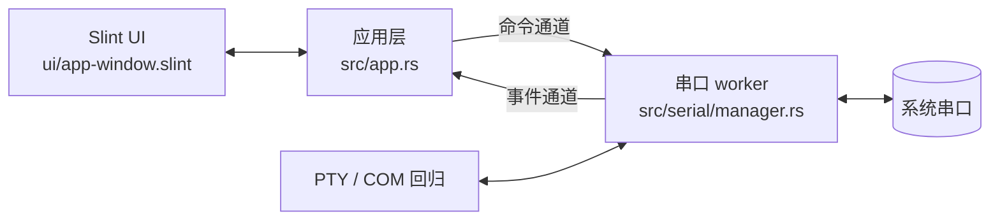

<div align="center">

# CitrusPort

**面向 Linux 和 Windows 的桌面串口调试工作台。**

Rust + Slint · 文本与 HEX · UTF-8 / GBK / ASCII · RTS / CTS / Break · 进程内 PTY 与 COM 回归测试

[](https://github.com/iesaka22333/citrus-port/actions/workflows/ci-release.yml)
[](Cargo.toml)
[](#获取与安装)
[](Cargo.toml)
[](https://slint.dev/)
[](#许可证)

[English](README.md) · **简体中文**

[概览](#概览) · [功能](#功能) · [获取与安装](#获取与安装) · [快速上手](#快速上手) · [构建与测试](#构建与测试) · [架构](#架构) · [性能](#性能) · [故障排查](#故障排查) · [路线图](#路线图) · [许可证](#许可证)

</div>

---

## 概览

> CitrusPort 是一个桌面串口终端，用于连接单片机、USB 转串口、调制解调器以及其他以串口形式出现的设备。

它把紧凑的 Material 风格界面和线程化串口后端组合在一起：端口发现、文本与原始字节收发、流式解码、有上限的通信日志以及控制线操作。项目使用 Rust 和 [Slint](https://slint.dev/) 构建，支持 Linux 和 Windows。

| 一览 | |
| :-- | :-- |
| **快速开始** | 自动发现端口，或直接输入设备路径；默认 115200 / 8N1 即可打开。 |
| **文本与字节** | 支持 UTF-8、GBK、ASCII、HEX 发送、可选换行和精确字节控制。 |
| **好用的日志** | 时间戳、拖选复制、`Ctrl+C`、自动滚屏、清空和保存文件。 |
| **真实控制线** | CTS 状态显示，RTS 与 Break 通过 `serialport` 实际操作。 |
| **可回归** | Unix 进程内 PTY 测试、Windows COM 配对测试和共用收发场景。 |

---

## 功能

| | 功能 | 说明 |
| :-- | :-- | :-- |
| 🔌 | **端口** | 定期枚举并显示产品名，同时支持手动填写端口路径。 |
| ⚙️ | **串口参数** | 波特率、5–8 数据位、None/Even/Odd 校验、1/2 停止位、XON/XOFF 或 RTS/CTS 流控。 |
| 🔤 | **编码** | UTF-8、GBK、ASCII。GBK 会发送真正的 GBK 字节；ASCII 遇到非 ASCII 字符会报错。 |
| 🔁 | **发送模式** | 文本或 HEX，支持 CRLF / LF / CR / NONE 换行。HEX 模式可解析 `01 02 FF` 形式的输入。 |
| 📜 | **接收日志** | 带时间戳的流式显示、HEX 显示、合并批次刷新、只读可选中文本。 |
| 📈 | **字节计数** | 工具栏显示原始 RX 字节数和成功写入的 TX 字节数。 |
| 🎛️ | **控制线** | CTS 周期读取并显示；RTS 和 Break 已接入串口操作。 |
| 🧹 | **日志操作** | 清空接收区，或保存到用户主目录下的 `citrusport-rx-<时间戳>.log`。 |
| ⚠️ | **错误处理** | 读写出错会写入日志、关闭串口，并丢弃未确认的发送记录。 |
| 🧪 | **测试** | Linux 上 15 个常规测试，包括 PTY 字节级双向校验和重连循环。 |

---

## 获取与安装

打 tag 的构建会发布到 [GitHub Releases](https://github.com/iesaka22333/citrus-port/releases)。

| 资产 | 平台 | 内容 |
| :-- | :-- | :-- |
| `citrus-port-<version>-x86_64-unknown-linux-gnu-release.tar.gz` | Linux | `citrus-port`、`README.md`、`LICENSE` |
| `citrus-port-<version>-x86_64-pc-windows-msvc-release.zip` | Windows | `citrus-port.exe`、`README.md`、`LICENSE` |
| `SHA256SUMS` | 全部 | 所有归档的校验和 |

校验下载文件：

```bash
sha256sum -c SHA256SUMS
```

Windows PowerShell 可使用：

```powershell
Get-FileHash -Algorithm SHA256 .\citrus-port-<version>-x86_64-pc-windows-msvc-release.zip
```

**Linux 运行环境**

- 使用 Wayland 或 X11 桌面会话。
- 确保当前账号有权访问串口节点，例如 `/dev/ttyUSB0` 或 `/dev/ttyACM0`。
- 如果提示权限不足，将账号加入 `dialout` 组，然后重新登录。

**Windows 运行环境**

- 确认设备在设备管理器中显示为 COM 端口。
- 如果系统未识别设备，请安装厂商驱动。

---

## 快速上手

1. **连接设备**并选择端口。端口字段既可以选择自动发现的条目，也可以手动输入 `/dev/ttyUSB0` 或 `COM4` 这类路径。
2. **匹配对端参数。** 默认值为 **115200 波特率、8 数据位、无校验、1 停止位、无流控**。
3. **发送数据。** 选择模式和换行后点击「发送」，或直接按 Enter。

| 目标 | 设置 | 输入 | 实际发送字节 |
| :-- | :-- | :-- | :-- |
| 普通文本命令 | 文本、UTF-8、CRLF | `AT` | `41 54 0D 0A` |
| 精确二进制帧 | HEX 发送、NONE | `01 02 FF` | `01 02 FF` |
| GBK 文本 + LF | 文本、GBK、LF | `你好` | `C4 E3 BA C3 0A` |

4. **查看并保存日志。** 拖选文本后按 `Ctrl+C` 复制，或点击「保存接收区」。保存路径会写回日志。

> **提示：** 阅读文本时关闭 HEX 显示；需要检查早期数据包时关闭自动滚屏。

---

## 构建与测试

### 环境依赖

| 平台 | 要求 |
| :-- | :-- |
| **Linux** | 支持 Rust 2024 edition 的稳定版 Rust、`pkg-config`、`libudev-dev`，以及 Slint 使用的 Wayland/X11 开发包。Debian/Ubuntu 示例：`build-essential pkg-config libudev-dev libxkbcommon-dev libwayland-dev libx11-dev libxcb-render0-dev libxcb-shape0-dev libxcb-xfixes0-dev libfontconfig1-dev libfreetype-dev`。 |
| **Windows** | Rust 稳定版 + MSVC 工具链、Visual Studio C++ 构建工具和 Windows SDK。 |
| **交叉构建** | 在 Linux 上构建 Windows 二进制默认使用 `x86_64-pc-windows-gnu`。先执行 `rustup target add x86_64-pc-windows-gnu`，并提供 MinGW 链接器。图形依赖可能需要额外工具链配置。 |

### Cargo 命令

```bash
cargo run --locked                 # 开发版
cargo build --release --locked     # release 产物位于 target/release/
cargo test --locked                # 当前平台的常规测试
```

首次构建需要联网拉取依赖。只有在依赖已缓存时才建议追加 `--offline`。

### 构建、测试与部署脚本

| 脚本 | 平台 | 作用 |
| :-- | :-- | :-- |
| `scripts/build.sh` | Linux / Unix | 构建和测试，生成英文报告。 |
| `scripts/build.ps1` | Windows PowerShell | 构建和测试原生或交叉目标。 |
| `scripts/deploy.sh` | Linux / Unix | 打包 `.tar.gz` 或 `.zip`，生成 `SHA256SUMS`。 |
| `scripts/deploy.ps1` | Windows PowerShell | 打包原生 `.zip` 或交叉构建的 `.tar.gz`。 |

**Linux / Unix**

```bash
./scripts/build.sh --platform linux --profile debug
./scripts/build.sh --platform linux --profile both --test
./scripts/deploy.sh --platform linux --profile release
```

**Windows PowerShell**

```powershell
.\scripts\build.ps1 --platform windows --profile debug
.\scripts\build.ps1 --platform windows --profile both --test
.\scripts\deploy.ps1 --platform windows --profile release
```

| 选项 | 说明 |
| :-- | :-- |
| `--platform <native\|linux\|windows\|all>` | 目标平台。 |
| `--profile <debug\|release\|both>` | 构建配置；`--mode` 是别名。 |
| `--target <triple>` | 为单一平台覆盖 Rust 目标三元组。 |
| `--test` / `--test-only` | 构建后测试，或跳过构建直接测试。 |
| `--ignored` | 先运行常规测试，再运行被忽略的性能采样。 |
| `--offline` | 向 Cargo 追加 `--offline`。 |
| `--report <path>` | 报告路径，默认 `test-results.txt`。 |
| `--clean` | 先执行 `cargo clean`。 |
| `--out <dir>` | 部署输出目录，默认 `dist/`。 |
| `--skip-build` | 直接打包已有产物，不重新构建。 |

报告默认写入仓库根目录，包含平台、目标、profile、命令、退出码、PASS/FAIL、解析后的计数和原始输出。

### 测试套件

| 套件 | 命令 | 说明 |
| :-- | :-- | :-- |
| 常规测试 | `cargo test --locked --offline` | x86_64 Linux 上 15 个测试（11 个库测试 + 4 个 PTY 测试）。 |
| Unix PTY | `cargo test --locked --offline --test pty_regression` | 进程内 PTY 对，不需要 `socat`。 |
| Windows COM | `cargo test --locked --offline --test com_regression -- --ignored --nocapture` | 需要 `CITRUS_TEST_PORT_A` 和 `CITRUS_TEST_PORT_B`。 |

PTY 治具覆盖双向字节流、反复关闭/重开、对端断开和应用层发送路径。COM 治具通过一对互通的串口复用同一套收发场景。

性能采样：

```bash
cargo test --locked --offline --test pty_regression -- --ignored --nocapture perf_pty_backend
cargo test --locked --offline -- --ignored --nocapture perf_app_state
```

---

## 架构



| 层 | 职责 |
| :-- | :-- |
| **UI** | Slint 组件和 Material 风格控件。所有属性更新都在 UI 线程完成。 |
| **应用层** | 注册回调、构造 `SendRequest`、合并接收事件、文本解码、维护字节计数，并以约 30 Hz 刷新日志。 |
| **串口 worker** | `SerialPort` 的唯一持有者。处理打开/关闭/发送、批量上报、CTS 轮询和读写失败。 |
| **通道** | `crossbeam-channel` 把 `Command` 发给 worker，把 `Event` 回投给应用层。 |
| **测试** | Unix PTY 和 Windows COM 目标共用收发、重连、编码和性能场景。 |

---

## 性能

x86_64 Linux、dev profile、进程内 PTY、512 B × 400 帧的本地基线：

| 路径 | p50 | p95 | p99 | 吞吐 |
| :-- | --: | --: | --: | --: |
| 对端写入 → `Received` | 0.6–0.8 ms | 1.0–1.5 ms | 16.9 ms | 约 11.5 MiB/s |
| 提交发送 → 对端读齐单帧 | 2.1 ms | 2.2 ms | 2.5 ms | 单帧往返约 233 KiB/s |
| 批量发送 → 对端读齐 | — | — | — | 31–47 MiB/s |

接收日志保持 5 MiB 上限：1 KiB 追加的 p50 约为 2.6 µs，触顶后每次回收 256 KiB，避免每个数据包都搬移整个缓冲区。

> 这些数据来自一台本地机器和一次构建，适合观察回归，不应作为跨机器硬性阈值。

---

## 故障排查

| 现象 | 处理方式 |
| :-- | :-- |
| Linux 提示 `Permission denied` | 将账号加入 `dialout`（`sudo usermod -aG dialout "$USER"`），然后重新登录。 |
| 端口被占用 | 关闭其他终端、IDE 或占用该设备的厂商工具。 |
| 没有发现端口 | 手动输入路径（`/dev/ttyUSB0`、`/dev/serial/by-id/...` 或 `COM4`）。 |
| Wayland/X11 构建错误 | 安装上面的 Slint 系统依赖，并使用受支持的桌面会话。 |
| Mark/Space/1.5 停止位被拒绝 | 当前 `serialport` 后端只支持 None/Even/Odd 和 1/2 停止位，请改用受支持的设置。 |
| Windows 找不到设备 | 安装 USB 转串口驱动，并在设备管理器中确认它显示为 COM 端口。 |

---

## 路线图

- [x] 端口发现、手动路径和主要串口参数。
- [x] 文本/HEX 收发、编码、换行和字节计数。
- [x] 可选中日志、复制、自动滚屏、保存和时间戳。
- [x] CTS 显示以及 RTS/Break 控制线操作。
- [x] PTY 回归、COM 治具、共用场景和英文报告。
- [x] Linux/Windows 构建、测试、打包脚本和 CI 发布流程。
- [ ] 在真实硬件上验证 Windows 原生构建、PowerShell 脚本和 COM 配对。
- [ ] 用设备验证 CTS/RTS/Break、硬件流控和 USB 拔插。
- [ ] 为 RTS/CTS 暂停/恢复验收增加成对虚拟 UART 驱动。
- [ ] 实现波形分析和协议解析页。

---

## 参与贡献

欢迎提交 Issue 和 Pull Request。提交前请运行：

```bash
cargo fmt --check
cargo clippy --all-targets
cargo test --locked --offline
```

较大的改动请附上相关回归结果，并说明测试环境是 Linux、Windows、PTY 还是真实硬件。开发说明和架构约束见 [AGENTS.md](AGENTS.md)。

---

## 许可证

CitrusPort 使用 MIT 许可证，详见 [LICENSE](LICENSE)。
